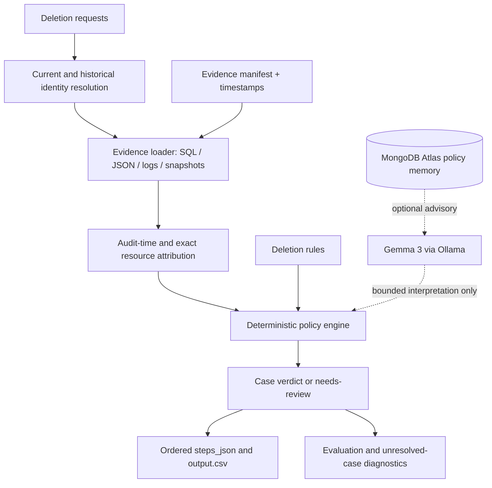

# 👻 GhostTrace AI

### Evidence-First Deletion Auditing · Historical Identity Resolution · Policy-Governed Remediation

**When a company says “your data is deleted,” GhostTrace asks: can it actually prove it?**

[](https://www.python.org/)
[](https://github.com/agcodes0315/GhostTrace-AI)
[](https://www.mongodb.com/atlas)
[](https://ollama.com/library/gemma3)

> **25 October 2026 evaluated build:** 54 automated tests passed; 518 submission rows passed structural validation; **424 provisional evidence-driven case classifications and 94 unresolved reviews**. Public samples: 17/32 strictly predicted, 13/17 predicted statuses correct, 3/17 exact step arrays. The emergency fallback produced 22/32 matching sample statuses and 3/32 exact arrays. **Provisional or fallback does not mean independently verified.** See [`evaluation/evaluation_report.md`](evaluation/evaluation_report.md).

---

## 🎯 The Problem: Ghost Data Still Exists

In the **Northstar Shop** scenario, a deletion workflow reported success while copies of personal data survived in search indexes, analytics, support records, exports and backups. A later sync/restore could even recreate deleted information. A primary-database delete isn't proof of end-to-end erasure.

**GhostTrace AI** reconstructs the user's historical identifiers, correlates evidence across systems, applies deletion/retention rules, and emits ordered *findings → remediation → verification* steps. Crucially, it distinguishes **observed evidence**, **proposed future actions**, and **claims that cannot yet be verified**.

## 🚀 Core Capabilities

| Capability | What GhostTrace actually does |
|---|---|
| 🔎 Historical identity linking | Resolves current/historical user identifiers with exact, typed reference matching |
| 🧾 Multi-format evidence | Parses JSON, JSON-lines, nested snapshots, SQLite-compatible SQL exports, and typed log readbacks |
| ⏱️ Audit-time reconstruction | Excludes evidence observed after each request's `audit_at`; evaluates known resource states and changes |
| 🛡️ Policy-aware treatment | Plans DELETE, REDACT, ANONYMIZE or RETAIN based on the record category and supplied rules |
| 🔁 Resurrection checks | Inspects relevant sync, connector and restore activity for possible reintroduction risks |
| 🧠 Optional policy AI | Uses Atlas vector search and local Ollama/Gemma for **advisory** policy interpretation; AI cannot fabricate evidence or override deterministic status |
| ✅ Regression and evaluation | Unit tests, structural output validation, labeled-sample comparisons and step-level diagnostics |

## 🏗️ Architecture



**Trust boundary:** Retrieval and model interpretation are not proof. The deterministic engine must identify the subject, resource, admissible timestamp, evidence ID and observed state; unsupported claims remain unresolved.

## ⚙️ Run Locally

**Requirements:** Python 3.12+ recommended. The deterministic audit and submission generator require **no API key**. Keep the organizer-supplied `dataset/` next to `code/`. **Do not include the dataset in `code.zip` or publish personal identifiers.**

```powershell
# From the root of the original challenge checkout
python -m unittest discover -s code/tests -v

# Inspect evidence and sample coverage
python code/ghosttrace.py all
python code/evaluate.py
python code/sample_diff_report.py

# Strict evidence-backed audit: does not silently fill gaps
python code/main.py --audit

# Emergency structural submission fallback, explicitly NOT independently audited
python code/emergency_submit.py
python code/validate_output.py
```

The **strict auditor intentionally refuses to produce a complete submission** when some cases lack sufficient evidence. `emergency_submit.py` instead outputs all 518 rows, with `INCOMPLETE`/`[]` on unresolved cases; that fallback is a placeholder, **not a proven incomplete finding**, and does not fulfill the full semantic step requirements for those rows.

## 📊 Evaluation Snapshot · 25 October 2026

| Measure | Reproduced result |
|---|---:|
| Automated regression tests | **54 passed** |
| Structural CSV validation | **518/518 rows passed** |
| Provisional classifications | **424/518** |
| Unresolved, requiring review | **94/518** |
| Output statuses | 171 `COMPLETE`, 342 `INCOMPLETE`, 5 `NOT_APPLICABLE` |
| Strict sample coverage | **17/32** |
| Strict status accuracy (on predicted samples) | **13/17 = 76.47%** |
| Strict exact ordered step arrays | **3/17 = 17.65%** |
| Strict operation sequence matches | **4/17 = 23.53%** |
| Emergency fallback status matches (all 32 samples) | **22/32 = 68.75%** |
| Emergency fallback exact step arrays (all 32 samples) | **3/32 = 9.38%** |

**Why 342 `INCOMPLETE` is not 342 bugs:** 248 rows have provisional evidence-based incomplete classifications; 94 are unresolved rows set to `INCOMPLETE` by the emergency fallback. Incomplete can be the **correct** outcome when data remains or a process can resurrect it; changing it to `COMPLETE` without proof would be a serious audit error. The 424 classifications are provisional, not end-to-end audited guarantees.

See [`evaluation/evaluation_report.md`](evaluation/evaluation_report.md) and [`evaluation/usage_report.md`](evaluation/usage_report.md) for methods, metrics, cost and known limitations.

## 🗂️ Project Files

```text
GhostTrace-AI/
├── code/
│   ├── engine.py                    # Deterministic case/step engine
│   ├── inspector.py                 # Historical identity resolution
│   ├── sql_snapshot_evidence.py     # Extract nested SQL replica records
│   ├── typed_text_readbacks.py      # Recover explicit log/handover readbacks
│   ├── snapshot_records.py          # Timestamped snapshot records
│   ├── main.py                      # Strict audit entrypoint
│   ├── emergency_submit.py          # Disclosed fallback CSV builder
│   ├── validate_output.py           # Structural validation
│   ├── evaluate.py                  # Public sample metrics
│   ├── sample_diff_report.py        # Exact step mismatch diagnostics
│   ├── atlas_gemma_workflow.py      # Optional policy demonstration
│   └── tests/                       # Regression tests
├── evaluation/
│   ├── evaluation_report.md
│   └── usage_report.md
├── README.md
└── output.csv                      # Generated emergency submission CSV
```

The organizer's `dataset/` is **required to rerun** full-data evaluation but is deliberately excluded from the public source archive. See `AGENTS.md` and `problem_statement.md` in the challenge submission archive for the challenge's contract.

## 🔐 Known Limitations and Safety

- **94 cases lack sufficiently attributable evidence or a supported final state.** Emergency placeholders are not verified outcomes.
- The engine does not fully interpret every PDF/image source; some records and policy implications may remain undiscovered.
- Hidden-set correctness is unknown; a structurally valid 518-row CSV cannot certify completeness or exact-step correctness.
- Evidence, operation results and workflow `reported_status` have different semantics. A reported deletion is not sufficient proof.
- Timestamps and source context must be preserved; post-cutoff evidence must not backdate a state.
- Optional local Gemma and MongoDB Atlas demonstrations do not autonomously delete customer data. Do not publish credentials or unredacted source records.

## 🏆 HackerRank Orchestrate October 2026

**Challenge:** Ghost Data Still Exists — evidence-backed deletion audit. Submission artifacts are `output.csv`, `code.zip`, and the authentic development chat transcript. This is a contest prototype, not a certified privacy-compliance service.

## 👩‍💻 Developer & Contact

**Agrima Saxena**
Software Engineering · Backend Systems · Applied AI · Cybersecurity

<a href="https://www.linkedin.com/in/agrima-saxena-142960426/" title="LinkedIn"></a>&nbsp;&nbsp;
<a href="mailto:agrimalc@gmail.com" title="Email"></a>&nbsp;&nbsp;
<a href="https://github.com/agcodes0315" title="GitHub"></a>

---

**GhostTrace principle:** *A deletion claim is not deletion evidence. A trustworthy agent must be able to show what remains, what action is needed, and how to verify it.*
